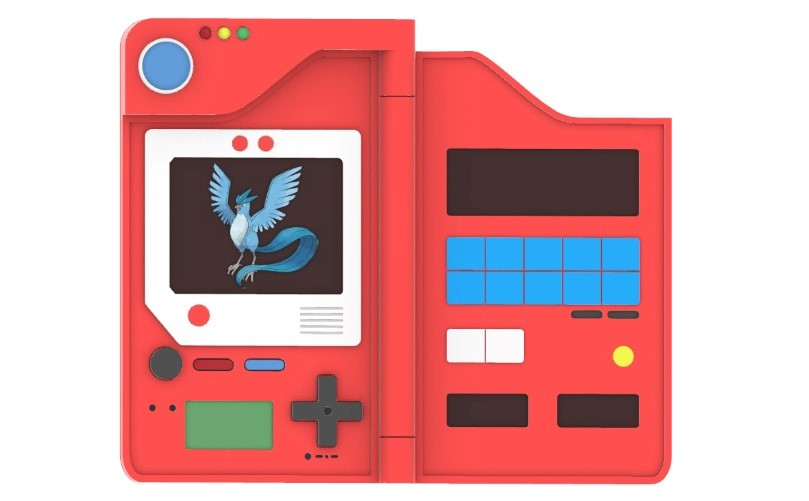

# Pokédex Next.js

A Pokédex you can browse in the browser, styled after the handheld device from the original Pokémon games. It has a red metal body, a sprite screen on the left, and a data screen on the right. You move through Pokémon and their sprites with the on-screen D-pad, and the buttons on the right switch between data tabs.

All data comes live from [PokéAPI](https://pokeapi.co/). The app has no database, backend, or API keys.

<p align="center">
  
  <br />
  <em>Design reference for the device shell</em>
</p>

---

## Features

- **Device-style UI.** The left/right layout looks like the hinged Pokédex, built with Tailwind, CSS Modules, a metal texture, inset "ridge" shadows and pixel-style Google fonts (DotGothic16 and Nanum Gothic Coding).
- **D-pad navigation:**
  - **Up / Down:** go to the next or previous Pokémon, across all ~1,300 PokéAPI entries. The list wraps around at both ends.
  - **Left / Right:** cycle through every sprite for the current Pokémon (official artwork first, then front/back, shiny, and per-generation variants).
  - The centre of the D-pad shows the current Pokédex number.
- **Hint display.** A small screen under the main image tells you what each D-pad direction will do next.
- **Data tabs**, each with its own URL:

  | Tab | Shows |
  | --- | --- |
  | **Overview** | Name, type, flavour text, height/weight (converted to metric), abilities, evolution summary, legendary/mythical status, capture rate |
  | **Forms** | Each form's types, version group, and mega/battle-only flags |
  | **Games** | Every game version the Pokémon appears in |
  | **Abilities** | Each ability with its short effect text |
  | **Evolutions** | The whole evolution chain with trigger details (level, item, happiness, time of day…), each stage linking to its own entry |
  | **Moves** | *Coming soon* (the nav button exists, but the page isn't built yet) |

- **Shareable URLs.** The Pokémon, the tab, and the sprite index (`?imageIndex=`) all live in the URL, so any view can be bookmarked or linked.
- **Per-page metadata.** Each tab sets its own `<title>` and description, e.g. *"Charizard - Evolutions"*.
- **JSON endpoint.** `GET /api/{name-or-id}` returns the same normalised Pokémon object the UI uses.

## Tech stack

| Area | Tools |
| --- | --- |
| Framework | [Next.js 14](https://nextjs.org/) (App Router, React Server Components, parallel routes) |
| Language | TypeScript 5 |
| UI | React 18, [Tailwind CSS 3](https://tailwindcss.com/), CSS Modules, [react-icons](https://react-icons.github.io/react-icons/), `classnames` |
| Data | [PokéAPI v2](https://pokeapi.co/docs/v2) via `fetch` in server components |
| Images | `next/image`, with remote sprites allowed from `raw.githubusercontent.com/PokeAPI/**` |

## Getting started

### Prerequisites

- Node.js **18.17 or newer** (required by Next.js 14)
- npm (a `package-lock.json` is committed)

### Install and run

```bash
git clone https://github.com/slangberg/pokedex-nextjs.git
cd pokedex-nextjs
npm install
npm run dev
```

Then open **http://localhost:3000/pokedex** and pick a Pokémon with the D-pad. You can also go straight to one, for example http://localhost:3000/pokedex/pikachu/overview.

> The app fetches from `pokeapi.co` at request time, so you need an internet connection, even in development.

### Scripts

| Command | Description |
| --- | --- |
| `npm run dev` | Start the dev server on port 3000 |
| `npm run build` | Create a production build |
| `npm start` | Serve the production build |
| `npm run lint` | Run ESLint (`next/core-web-vitals`) |
| `npm run lint:fix` | Run ESLint and fix what it can automatically |
| `npm run type-check` | Type-check with `tsc --noEmit` |

## Routes

```
/pokedex                       Empty device; use the D-pad to choose a Pokémon
/pokedex/[slug]                Redirects to /pokedex/[slug]/overview
/pokedex/[slug]/overview       ┐
/pokedex/[slug]/forms          │
/pokedex/[slug]/games          ├─ rendered in the right-hand screen via the @screen parallel route
/pokedex/[slug]/abilities      │
/pokedex/[slug]/evolutions     ┘
/api/[slug]                    JSON: normalised PokemonData
```

`[slug]` is anything PokéAPI accepts as a Pokémon identifier: a name (`bulbasaur`) or a national dex number (`1`).

## How it works

### Layout and parallel routes

`src/app/pokedex/[slug]/layout.tsx` is a server component. It fetches the selected Pokémon plus the full Pokémon list and renders `MainLayout`, which has two halves:

- **LeftSide:** the sprite slideshow, the D-pad, and the hint display. These are client components that read and write the URL with `useRouter`, `useParams` and `useSearchParams`.
- **RightSide:** the data screen and the tab buttons. The screen's content is the `@screen` [parallel route](https://nextjs.org/docs/app/building-your-application/routing/parallel-routes) slot. Each tab is its own `@screen/<tab>/page.tsx`, and `@screen/default.tsx` redirects to `overview`.

### Data layer (`src/utils/api.ts`)

`getAllData(slug)` calls `genPokemonData(slug)`, which turns several PokéAPI resources into one typed `PokemonData` object (see `src/types/data.ts`):

1. `GET /pokemon/{slug}`: base stats, sprites, cries, game indices.
2. `normalizeAbilities`: fetches each ability in parallel and keeps the English effect and flavour text.
3. `normalizeForms`: fetches each form for its types, version group, and mega/battle-only flags.
4. `normalizeSpecies`: species info, growth rate, egg groups, Pokédex numbers, and English flavour text.
5. `normalizeEvolutionChain`: walks the evolution tree depth-first and flattens it into a list of stages with their trigger details.
6. `createPokemonOverview`: builds the human-readable summary shown on the Overview tab (metric units, capture-rate %, gender ratio).

The layout and every tab page call `getAllData` independently. Next.js's `fetch` request memoisation removes the duplicate network calls within a single render.

### Navigation state

| Control | State | Where |
| --- | --- | --- |
| D-pad up/down | Path segment `/pokedex/{name}/overview` | `usePokemonIndexes` in `src/utils/route.ts` |
| D-pad left/right | Search param `?imageIndex=n` | `usePageIndex` / `usePokemonImageData` in `src/utils/route.ts` |
| Tab buttons | Last path segment (`overview`, `forms`…) | `ButtonNav` / `MainNavLink` in `src/components/RightSide/` |

## Project structure

```
src/
├── app/
│   ├── layout.tsx               Root layout: fonts and global CSS
│   ├── pokedex/
│   │   ├── page.tsx             Empty device shell
│   │   ├── error.tsx            Error boundary (e.g. unknown Pokémon)
│   │   └── [slug]/
│   │       ├── layout.tsx       Fetches data, renders the device
│   │       └── @screen/         Parallel-route tabs (overview, forms, games, abilities, evolutions)
│   └── api/[slug]/route.ts      JSON endpoint
├── components/
│   ├── Global/                  MainLayout, indicator lights, display items
│   ├── LeftSide/                Slideshow, D-pad, hint display
│   └── RightSide/               Data screen, headings, tab buttons
├── types/                       PokemonData, Species, Evolution, page prop types
├── utils/
│   ├── api.ts                   PokéAPI fetching and normalisation
│   ├── route.ts                 Client hooks for D-pad and slideshow state
│   ├── data.ts                  Formatting helpers (pick, addSpaces, yes/no…)
│   └── navigation.ts            Search-param helpers
└── fonts.ts                     next/font Google font setup
public/                          Metal and screen textures, Pokéball, Pokémon GB font
```

## Roadmap

- [ ] **Moves** tab (the nav button already exists)
- [ ] Search on the empty `/pokedex` screen and the landing page at `/`
- [ ] Play Pokémon cries (`sounds` is already in `PokemonData`)
- [ ] An AI Pokédex assistant. There's an experimental LangChain/OpenAI agent in `src/actions/test.ts`, but the UI doesn't use it yet. It would need `OPENAI_API_KEY` and `TAVILY_API_KEY`.
- [ ] Tests

## License

[MIT](./LICENSE) © 2024 Sam Langberg

Pokémon and Pokémon character names are trademarks of Nintendo, Game Freak and The Pokémon Company. This is an unofficial fan project for learning and is not affiliated with or endorsed by them. Data and sprites come from [PokéAPI](https://pokeapi.co/).
